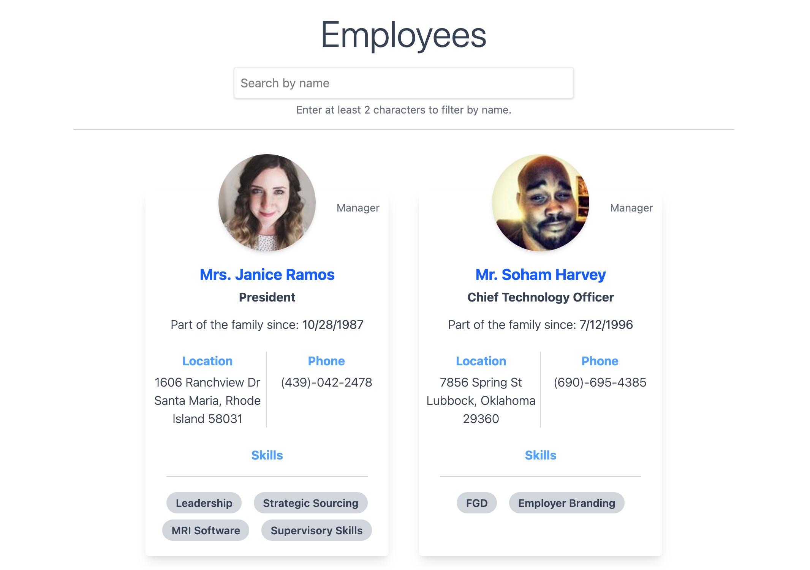

# Employee directory (Vue 3)

A small **employee directory** with search, contact cards, and skills—built to read well as a portfolio piece: modern tooling, tests, CI, and a clear data story.

### Screenshot



## Stack

- [Vue 3](https://vuejs.org/) (Composition API, `<script setup>`)
- [Vite](https://vitejs.dev/)
- [Tailwind CSS](https://tailwindcss.com/) v4 (`@tailwindcss/vite`)
- [axios](https://axios-http.com/) for HTTP
- [Vitest](https://vitest.dev/) + [Vue Test Utils](https://test-utils.vuejs.org/)
- [ESLint](https://eslint.org/) (flat config) + `eslint-plugin-vue`

## Quick start

```bash
npm install
npm run dev
```

Open the URL Vite prints (usually `http://localhost:5173`).

## Scripts

| Command           | Description              |
| ----------------- | ------------------------ |
| `npm run dev`     | Dev server with HMR      |
| `npm run build`   | Production build → `dist/` |
| `npm run preview` | Preview production build |
| `npm run test`    | Unit tests (Vitest)      |
| `npm run lint`    | ESLint                   |

## Data & axios (dummy static JSON)

Employee records are served as static JSON—**no backend**.

The app loads them with **axios** `GET` against `public/employees.json` (URL built with `import.meta.env.BASE_URL` so it still works if the app is hosted under a subpath, e.g. GitHub Pages).

That pattern is intentional: many take-homes and interview scopes ask for **axios** and a “fetch list then render” flow. Here, the “API” is a static file; swapping in a real base URL is a one-line change in [`src/App.vue`](src/App.vue) (see the comment above `EMPLOYEES_JSON_URL`).

To update roster data, edit [`public/employees.json`](public/employees.json) (same shape: `{ "results": [ ... ] }`).

## Tests

[`src/utils/filterEmployees.test.js`](src/utils/filterEmployees.test.js) covers name filtering. [`src/App.spec.js`](src/App.spec.js) mocks **axios** and checks load + empty search state—no network calls in CI.

## Notes

- Profile images use remote URLs (e.g. `randomuser.me`); you need network access to see photos in the browser.
- CI runs on `main` / `master` via [`.github/workflows/ci.yml`](.github/workflows/ci.yml).

## License

Add a `LICENSE` file if you publish the repo publicly.
